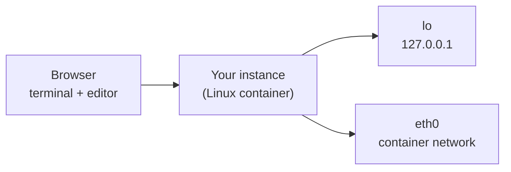

# Linux Network Basics

In this lab you take your first look at the network configuration of a Linux system. You will
inspect the network interfaces of your instance, test connectivity with `ping` and make a small,
persistent change to your shell configuration.



## What you will learn

- How to list network interfaces and their IP addresses with `ip addr`.
- How to test reachability with `ping` and how to read its summary.
- How to add a shell alias to `~/.bashrc` so it is available in every new shell.

## Task 1 — Inspect your network interfaces

Run the following command in the terminal:

```sh
ip addr
```

Look at the output: every interface (e.g. `lo`, `eth0`) is listed with its state and the
addresses assigned to it. Lines starting with `inet` show IPv4 addresses, lines starting with
`inet6` show IPv6 addresses.

**Question:** Which IPv4 address does the loopback interface `lo` have? Which one does `eth0` have?

When you are done, click step 1 ("show your interfaces with ip addr") in the step bar at the top to run the check.

## Task 2 — Test connectivity with ping

Send exactly three ICMP echo requests to the loopback address:

```sh
ping -c 3 127.0.0.1
```

`-c 3` stops `ping` after three packets. At the end, `ping` prints a summary such as
`3 packets transmitted, 3 received, 0% packet loss`.

**Hint:** If you forget `-c 3`, `ping` runs forever — stop it with `Ctrl+C` and run it again with
`-c 3`.

When you are done, click step 2 in the step bar to run the check.

## Task 3 — Add an alias to your shell configuration

Typing `ip -4 addr show` every time is tedious. Create a shortcut:

1. Open the file `bashrc` in the editor (it is your `/home/p4/.bashrc`).
2. Add the following line at the end of the file and save it:

   ```sh
   alias myip='ip -4 addr show'
   ```

3. Load the changed configuration in the terminal and try your alias:

   ```sh
   source ~/.bashrc
   myip
   ```

When you are done, click step 3 in the step bar to run the check.

## Reflection questions

1. Why does a ping to `127.0.0.1` work even if the instance has no connection to other hosts?
2. Why do you need `source ~/.bashrc` (or a new shell) before the alias works?
3. Step 1 and step 2 only search your terminal output, while step 3 checks the file on the
   instance. What can each kind of check verify — and what can it not verify?
