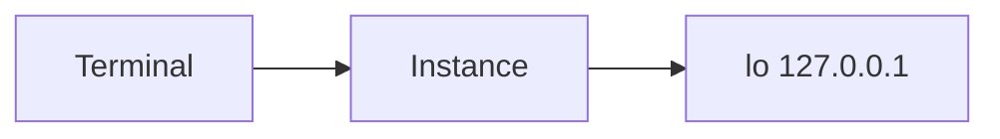

# Network-Basics

Small first look at the network stack of your lab instance.

## Task 1 — Inspect interfaces

Run `ip -brief addr`. Which interfaces exist? Which address does `lo` have?

## Task 2 — Check reachability

Run `ping -c 3 127.0.0.1` and look at the round-trip times.

## Task 3 — Record your observation

Open `answers.md` in the editor. Explain in 2–3 sentences what the loopback
interface is used for and why the ping times are so low. Click **Deploy** in the
editor to save the file to your instance, and check with `cat ~/answers.md`.

## Reflection

1. Why does step 2 only check the terminal buffer and not the real network
   state?
2. How would you check reachability of a second node in a containerlab topology?
