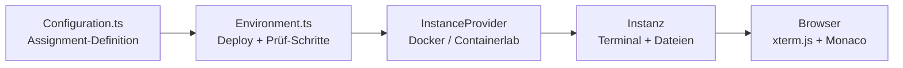

<!-- Die verbindliche Kopie liegt als backend/src/assignments/onboarding-tour-german.md im Repo
     (dort lädt der Backend die Lab-Sheets her); diese Kopie dient nur dem Onboarding-Ordner
     als Auffindbarkeit. Änderungen zuerst in backend/src/assignments/ vornehmen und dann
     hierher spiegeln. Registriert über Configuration.ts als Assignment "Onboarding-Tour".
     Das -german-Suffix kennzeichnet das deutschsprachige Assignment
     (Konvention: prona-sdn-intro-german.md). -->

# Onboarding-Tour

Willkommen im Bachelor-Projekt! In dieser Übung baust du **dein erstes eigenes Assignment** in
learn-sdn-hub — klein, aber vollständig: ein Terminal, eine editierbare Datei, zwei Prüf-Schritte.

Ziel ist nicht das Ergebnis, sondern das Verständnis: Wo wird ein Assignment definiert, wie kommt
es im Browser an, wie prüft die Plattform deine Arbeit?

## Was du hier lernst

- Wie ein Assignment als Datenobjekt (`EnvironmentDescription`) aussieht und welche Felder wirken.
- Wie der Terminalpfad vom Browser über WebSocket bis auf die Instanz läuft.
- Wie Prüf-Schritte funktionieren (`SSHCommand`, `TerminalBufferSearch`) und wie Hinweise gestuft werden.
- Wie eine Änderung über Branch → PR → Review → CI in das Projekt kommt.

## Voraussetzungen

- Lauffähige Entwicklungsumgebung (siehe `onboarding-german/runbook-setup.md`).
- Repository-Zugriff und ein Issue für deine Aufgabe.

## Aufgabe 1 — Umgebung lesen

1. Öffne das Assignment im Browser und sieh dir an, welche Terminals und Dateien es anbietet.
2. Führe im Terminal `uname -a` aus, falls der erste Prüf-Schritt noch nicht grün ist.

**Hinweis:** Wenn der Schritt rot bleibt, prüfe im Environment-View, ob die Instanz wirklich
gestartet ist (Provider-Status, Ports) — die Fehlermeldung nennt den fehlgeschlagenen Check.

## Aufgabe 2 — Terminalverlauf als Prüfkriterium

Führe im Terminal `whoami` aus. Der zweite Schritt prüft nur den **Terminalpuffer**, nicht den
Zustand der Instanz — ein gutes Beispiel dafür, wie unterschiedlich Prüf-Schritte sein können.

## Aufgabe 3 — Das Assignment erweitern

1. Ergänze im Lab-Sheet `backend/src/assignments/onboarding-tour-german.md` einen eigenen Abschnitt
   mit einer Beobachtung, die dir aufgefallen ist.
2. Ergänze in `backend/src/Configuration.ts` im Eintrag `Onboarding-Tour` **einen** weiteren
   Prüf-Schritt (z. B. `SSHCommand` mit `command: "ls /home/p4"`).
3. Deploye neu und verifiziere, dass alle Schritte grün werden.

**Wichtig:** Nur Beobachtbares prüfen (Exit-Status, Ausgabe, Terminalpuffer), keine
Implementierungsdetails.

## Reflexionsfragen

1. Welche Rolle spielt `Configuration.ts` und welche `Environment.ts`? Wo würdest du ein neues
   Feld für ein Assignment ergänzen?
2. Welcher Teil des Terminalpfads hat dich beim Lesen am meisten überrascht?
3. Wo hättest du für deine Erweiterung Hilfe von einem Werkzeug gebraucht — und wo hat es dich
   in die Irre geführt?
4. Was würdest du an diesem Lab-Sheet ändern, damit die nächste Gruppe schneller ankommt?
5. Welche Grenze hat ein Test wie `TerminalBufferSearch`? Nenne ein Szenario, das er **nicht**
   zuverlässig prüfen kann.

## Abgabe

- Branch `feature/<issue>-onboarding-tour` mit: geänderter `Configuration.ts`, geändertem
  Lab-Sheet, PR-Beschreibung mit **Plan-Absatz** (Ziel, Akzeptanzkriterium, betroffene Dateien)
  und **KI-Notiz** (Tool/Kategorie, Anwendungsfall, Grad der manuellen Nacharbeit).
- Nachweis: Screenshot der grünen Schritte; `npm test`, `npm run lint`, `npm run type-check` grün.

## Referenzen

- `README.md` — Betrieb und Assignment-Konfiguration.
- `backend/src/Configuration.ts` — Beispiele für Terminals, Dateien, Schritte, Submissions.
- `onboarding-german/slides/code-tour.md` — Code-Tour (Architektur).
